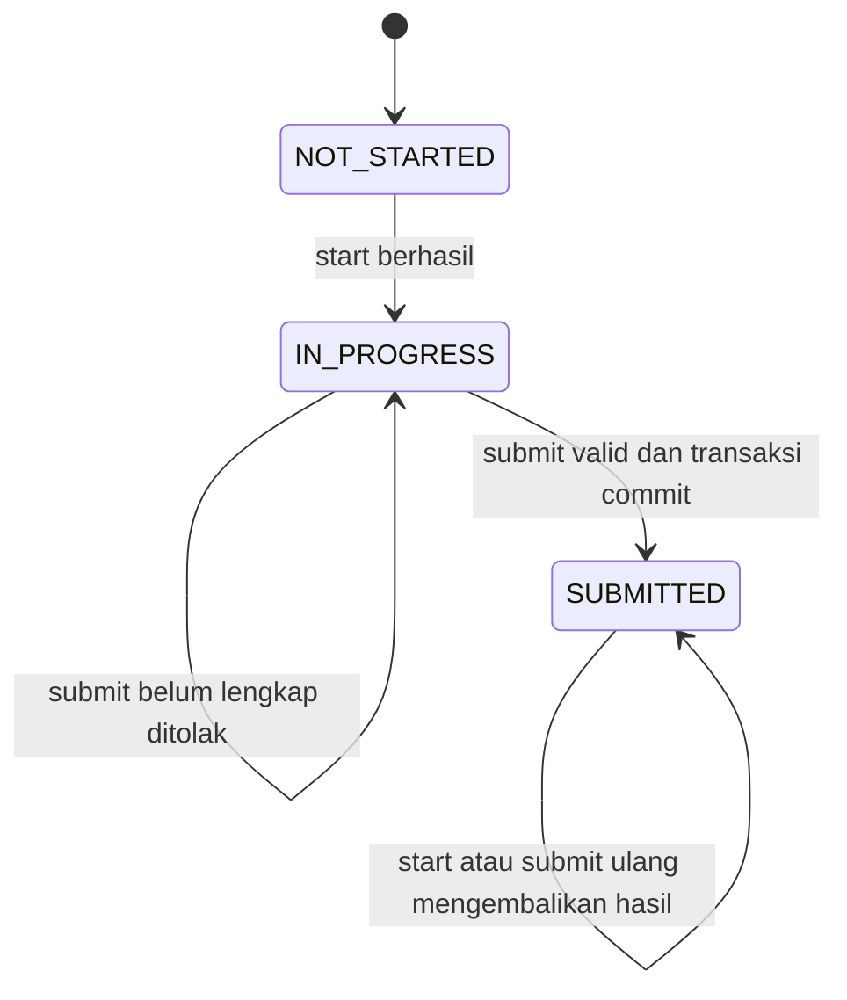
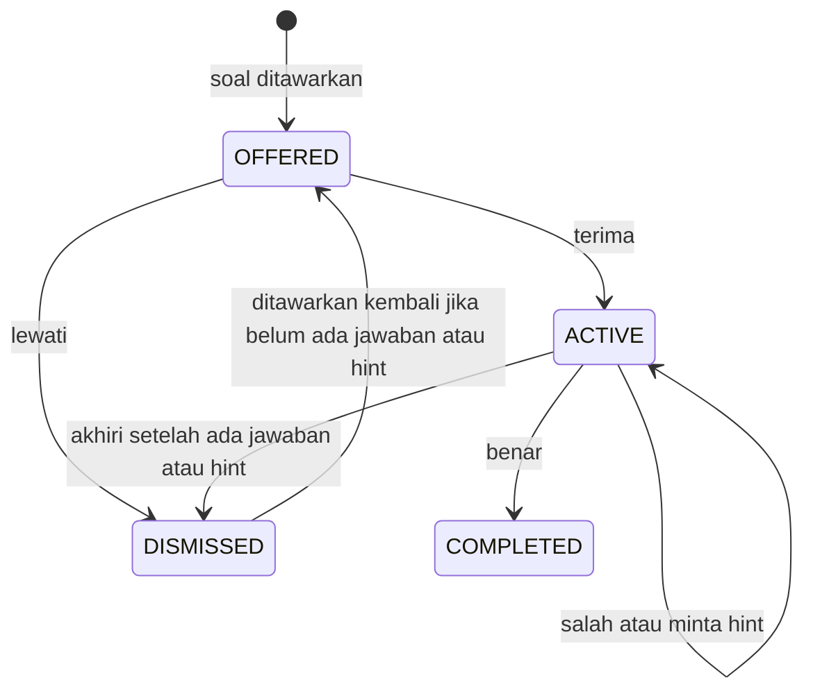

# State dan skenario adaptive engine

Dokumen ini menjelaskan perilaku kode saat diperiksa pada 30 Oktober 2026. Cakupannya adalah pretest, profil indikator, keputusan tutor, latihan, pencatatan belajar, dan posttest. Tabel skenario merupakan penelusuran cabang kode, bukan laporan pengujian integrasi dengan akun mahasiswa atau Gemini.

## 1. State ada pada beberapa objek yang berbeda

| Objek | Lokasi | State atau nilai |
| --- | --- | --- |
| Sesi assessment | `assessment_attempt.status`, dibedakan oleh `kind=PRE/POST` | `IN_PROGRESS`, `SUBMITTED` |
| Assessment belum dimulai | Respons API; belum ada baris attempt | `NOT_STARTED` |
| Kemampuan awal | `student_indicator_profile.initialStatus` | `NEEDS_REINFORCEMENT`, `INITIAL_POSITIVE_EVIDENCE` |
| Kemampuan terkini | `student_indicator_profile.currentStatus`; dihitung ulang saat profil dibaca | `NOT_ASSESSED`, `NEEDS_REINFORCEMENT`, `INITIAL_POSITIVE_EVIDENCE`, `DEVELOPING`, `READY_TO_ADVANCE` |
| Tindakan tutor per permintaan | Objek Python `adaptive`; setelah pesan tersimpan ada di `ai_chat_message.ragSources.adaptive.action` | `CLARIFY`, `FOUNDATION`, `APPLICATION`, `REVIEW`, `PRACTICE_HINT` |
| Sesi satu soal latihan | `practice_session.status` | `OFFERED`, `ACTIVE`, `DISMISSED`, `COMPLETED` |
| Event latihan | `practice_event.kind` | `ANSWER`, `HINT` |
| Kemandirian event | `practice_event.independent` | `true`, `false` |
| Progres belajar | `student_learning_progress` | Ada/tidak ada record, `startedAt`, `lastStudiedAt`; tidak ada kolom status |
| Kelayakan posttest | Respons `posttest_availability()` | `available`, `remainingStudySeconds`, `reason`; bukan enum tersimpan |

`COMPLETED` menyatakan satu soal selesai, bukan indikator dikuasai. `REVIEW` adalah tindakan tutor, bukan nilai kemampuan. `NOT_ASSESSED` bisa muncul dari LEFT JOIN profil yang belum ada; tidak berarti setiap indikator sudah memiliki baris dengan status itu.

## 2. Pretest: pembuatan, draf, dan finalisasi

Sumber: [AssessmentService](../services/rag/src/tutor_rag/assessment/service.py), [grade_responses](../services/rag/src/tutor_rag/assessment/scoring.py), [AssessmentPage](../src/components/assessment/assessment-page.tsx).



`NOT_STARTED` pada diagram adalah kondisi belum ada record, bukan nilai kolom database.

| Skenario | Perilaku aktual | Pengaruh ke profil |
| --- | --- | --- |
| Course belum memiliki konfigurasi | `start()` mengembalikan 404 | Tidak ada profil baru |
| Belum ada attempt, dataset valid | Ambil seluruh soal `PRE_POST`, urutkan kode indikator, buat attempt dan snapshot item | Belum membuat profil |
| Jumlah soal/indikator tidak sesuai konfigurasi | 409; transaksi dibatalkan | Tidak membuat profil |
| Klik mulai lagi ketika attempt sudah ada | Mengembalikan attempt lama; tidak mengacak atau membuat ulang paket | Tidak berubah |
| Pilih/ubah opsi pada snapshot soal | Simpan `selectedOption` dan `answeredAt` selama `IN_PROGRESS` | Tidak berubah |
| Pilihan tidak valid atau field wajib kosong | 422 | Tidak berubah |
| Soal bukan anggota attempt | 404 | Tidak berubah |
| Attempt salah atau bukan milik mahasiswa | 404 setelah pemeriksaan konteks | Tidak berubah |
| Submit dengan jawaban kosong | 409 dari validasi penilaian | Tetap `IN_PROGRESS`; belum ada profil baru |
| Submit lengkap | Nilai setiap item, isi `isCorrect`, buat satu profil per indikator, finalisasi attempt | Profil awal dibuat |
| Submit ulang setelah sukses | Hasil sebelumnya dikembalikan | Tidak membuat bukti/profil ganda |
| Ubah jawaban setelah finalisasi | 409 | Baseline tetap |
| Database gagal selama finalisasi | Transaksi penilaian/profil/finalisasi dibatalkan | Tidak meninggalkan sebagian profil dari transaksi itu |
| Simpan draf gagal di jaringan | UI mempertahankan pilihan tertunda di `localStorage`, menampilkan error | Tidak ada perubahan profil |
| Refresh saat draf tertunda | UI mencoba memulihkan dan mengirim pilihan tertunda dari perangkat tersebut | Tetap draf sampai submit |
| Submit saat simpan masih berlangsung | UI menunggu antrean; jika draf tertunda masih ada, submit tidak diteruskan | Tidak berubah |

Profil awal per indikator: benar menghasilkan skor 1 dan `INITIAL_POSITIVE_EVIDENCE`; salah menghasilkan skor 0 dan `NEEDS_REINFORCEMENT`. `currentScore=initialScore`, `currentStatus=initialStatus`, dan `evidenceCount=1`. Snapshot menyimpan soal serta kunci saat attempt dibuat, sehingga impor ulang tidak mengganti dasar penilaian attempt yang sudah terbentuk.

Constraint satu attempt per `(studentId, courseId, kind)` membuat satu sesi PRE dan satu sesi POST per mahasiswa/course dalam implementasi ini; tidak ada alur retake dalam service.

## 3. Status kemampuan indikator

Sumber: [operational_status](../services/rag/src/tutor_rag/learning/profile.py), [StudentIndicatorProfile](../prisma/schema.prisma).

Urutan keputusan harus dibaca dari atas ke bawah:

| Prioritas | Kondisi | Status hasil |
| --- | --- | --- |
| 1 | Profil tidak ada atau `initialScore` kosong | `NOT_ASSESSED` |
| 2 | `evidenceCount == 1` | Gunakan `initialStatus` |
| 3 | `currentScore >= readyThreshold` | `READY_TO_ADVANCE` |
| 4 | `currentScore >= developingThreshold` | `DEVELOPING` |
| 5 | Kondisi lain dengan baseline tersedia | `NEEDS_REINFORCEMENT` |

Default konfigurasi: `emaAlpha=0.3`, `developingThreshold=0.5`, `readyThreshold=0.8`. Nilai konfigurasi course di database yang dipakai saat runtime.

Implikasinya:

- Pretest benar menghasilkan `INITIAL_POSITIVE_EVIDENCE`, meskipun skornya 1; belum otomatis `READY_TO_ADVANCE`.
- Setelah ada latihan mandiri, status dapat naik maupun turun sesuai EMA.
- EMA 0 lalu jawaban salah tetap 0, tetapi jumlah bukti bertambah jika mandiri.
- Tampilan membulatkan EMA menjadi dua desimal, sedangkan klasifikasi membandingkan nilai asli. Nilai yang tampak sama setelah pembulatan belum tentu identik di database.
- `profile()` dan tutor menghitung status dari data bukti dan konfigurasi, bukan hanya membaca teks `currentStatus`. Jika ambang konfigurasi diubah, status yang dihitung dapat berbeda dari kolom tersimpan sampai pembaruan profil berikutnya.
- `initialScore`, `initialStatus`, dan `baselineItemId` tetap dipertahankan selama alur belajar normal.

## 4. Menentukan indikator dan tindakan tutor

Sumber: [AdaptiveTutoring](../services/rag/src/tutor_rag/learning/tutoring.py), [RagPipeline](../services/rag/src/tutor_rag/rag/pipeline.py), [service Next.js](../src/lib/tutor-ai/service.ts).

### 4.1 Pemeriksaan sebelum memilih indikator

| Kondisi | Perilaku |
| --- | --- |
| User tidak memiliki akses course | Permintaan ditolak |
| Course tidak memiliki konfigurasi domain | Tidak mewajibkan pretest melalui `needsPretest`; Python mengembalikan `adaptive=None`, menggunakan RAG biasa |
| Course dikonfigurasi, PRE belum `SUBMITTED` | Chat/latihan diblokir dengan pesan selesaikan pretest |
| Tidak ada PDF siap atau tidak ada materi terpilih | Next.js mengirim jawaban tetap keterbatasan sumber, `adaptive=null`; pemilihan indikator Python tidak dijalankan |
| Chat bukan milik mahasiswa/course | Ditolak; tidak memilih indikator |

### 4.2 Urutan pemilihan indikator

Kandidat dibatasi ke course mahasiswa dan materi terpilih yang terhubung melalui `courseSessionId` topik.

1. Cari satu kecocokan kode indikator atau nama konsep dalam pesan.
2. Jika belum unik, cari kecocokan kata deskripsi/konsep; pemenang harus memiliki sedikitnya dua kata yang cocok dan unggul dari kandidat berikutnya.
3. Jika meminta belajar kelemahan, pilih kandidat berstatus perlu penguatan. Jika pesan menyebut pretest, gunakan status awal; selain itu gunakan status terkini. Urutkan skor terendah, lalu skor terkini dan kode untuk pemilihan yang stabil.
4. Untuk pesan lain yang belum terpetakan, Gemini menerima pesan, dua potong riwayat terakhir, dan daftar indikator; hanya boleh mengusulkan ID resmi atau null.
5. Tidak ada hasil berarti `CLARIFY`.

Kecocokan konsep eksplisit mendahului permintaan kelemahan. Pemeriksaan frasa kelemahan memakai regex/kata tertentu; tidak semua variasi bahasa otomatis dipahami sebagai permintaan kelemahan. Gemini pada tahap pemilihan indikator tidak menerima seluruh skor profil dalam payload klasifikasi.

| Skenario pesan/konteks | Hasil |
| --- | --- |
| Menyebut satu konsep yang dikenali | Pilih indikator konsep tersebut |
| Meminta materi yang lemah tanpa menyebut topik | Pilih satu indikator perlu penguatan dari profil terkini dalam cakupan materi terpilih |
| Meminta materi yang lemah di pretest | Pilih dari kelemahan baseline, walaupun kemampuan terkini mungkin sudah meningkat |
| Beberapa indikator sama lemahnya | Urutan skor dan kode menentukan satu pilihan; tidak menjelaskan semuanya sekaligus |
| Tidak ada kandidat karena pemetaan materi tidak cocok | `CLARIFY` dengan pesan tentang pemetaan materi/indikator |
| Permintaan kelemahan, tetapi tidak ada indikator perlu penguatan dalam cakupan | `CLARIFY`; tidak memilih konsep lemah secara acak |
| Status semuanya `DEVELOPING` atau lebih baik | Permintaan kelemahan terkini tidak otomatis memilih yang paling rendah; filter saat ini hanya `NEEDS_REINFORCEMENT` |
| Sapaan/permintaan umum tidak terpetakan | Dapat berakhir `CLARIFY` |
| Klasifikasi Gemini gagal atau JSON/ID tidak valid | Menghasilkan tidak ada indikator; bisa terlihat sebagai `CLARIFY` |

### 4.3 Prioritas tindakan setelah indikator dipilih

| Kondisi | `action` | Respons |
| --- | --- | --- |
| Indikator tidak ditemukan | `CLARIFY` | Teks tetap; generasi jawaban Gemini dilewati |
| Ada latihan `ACTIVE` untuk indikator sama, `answerCount=0`, `hintCount=0` | `PRACTICE_HINT` | Teks tetap mengarahkan bantuan ke kartu hint; generasi penjelasan dilewati |
| Status perlu penguatan | `FOUNDATION` | Instruksi dasar bertahap |
| Status siap lanjut | `REVIEW` | Instruksi ulasan/rekomendasi |
| Status lainnya setelah indikator ditemukan | `APPLICATION` | Instruksi penerapan dan contoh; termasuk bukti positif awal |

`PRACTICE_HINT` diperiksa sebelum pemetaan status ke cara mengajar. Setelah jawaban salah pertama atau hint tercatat, kondisi latihan bersih tadi tidak lagi terpenuhi sehingga chat konsep dapat berlanjut.

### 4.4 Sumber, generasi, dan penawaran latihan

| Kondisi | Perilaku | Efek profil |
| --- | --- | --- |
| Aksi `CLARIFY`/`PRACTICE_HINT` | Tidak melakukan retrieval; kirim jawaban tetap | Tidak berubah |
| Indikator ditemukan dan chunks tersedia | Susun prompt dari sumber serta instruksi adaptif; coba tawarkan latihan | Tidak berubah hanya karena penjelasan |
| Retrieval menghasilkan nol chunks | Kirim jawaban tetap sumber tidak cukup; tidak menawarkan latihan | Tidak berubah |
| Embedding/retrieval melempar exception | Persiapan gagal; route RAG membungkus exception sebagai HTTP 502 | Tidak berubah |
| Ada chunks, tetapi bank soal tidak menyediakan latihan lagi | `offer()` menghasilkan null; action diubah menjadi `REVIEW` | Tidak menaikkan skor/status kemampuan |
| Generasi jawaban Gemini gagal | Error generasi/stream; tidak dianggap jawaban sukses | Tidak mengubah EMA |

Penawaran latihan dilakukan saat persiapan, sebelum generasi jawaban selesai. Jika generasi kemudian gagal atau dibatalkan, penawaran yang sudah commit dapat tetap ada; tidak ada satu transaksi bersama antara Python, Gemini, dan penyimpanan pesan Next.js.

`action` adalah catatan keputusan per pesan. Tidak ada state terminal global seperti “seluruh materi selesai” yang ditentukan dari rata-rata 14 EMA.

## 5. State sesi latihan

Sumber: [PracticeService.offer/change_status/current/interact](../services/rag/src/tutor_rag/learning/practice.py), [TutorPracticeCard](../src/components/tutor/tutor-practice-card.tsx).



| State | Makna | Soal/opsi dari API | Tindakan UI |
| --- | --- | --- | --- |
| `OFFERED` | Tawaran belum diterima | Disembunyikan | Terima atau lewati |
| `ACTIVE` | Soal sedang dikerjakan | Ditampilkan | Jawab, hint, dan akhiri jika sudah ada interaksi |
| `DISMISSED`, belum ada interaksi | Tawaran dilewati | Disembunyikan; kartu UI tidak dirender | Bisa ditawarkan lagi oleh engine |
| `DISMISSED`, sudah ada interaksi | Latihan diakhiri | Soal dan riwayat tetap dapat ditampilkan | Tidak bisa menjawab/hint lagi |
| `COMPLETED` | Pernah dijawab benar dalam sesi ini | Soal dan riwayat tersedia | Tidak bisa menjawab/hint lagi |

Aturan pemilihan tawaran:

1. Gunakan sesi `OFFERED` atau `ACTIVE` yang sudah ada untuk indikator sama, termasuk dari chat lain milik mahasiswa/course tersebut.
2. Jika tidak ada, pilih soal bank yang belum pernah memiliki sesi untuk mahasiswa/course itu, urut `practiceNumber` lalu kode.
3. Jika semua soal sudah pernah memiliki sesi, cari tawaran `DISMISSED` yang belum pernah dijawab dan belum pernah diberi hint; tawarkan kembali.
4. Jika tidak ada, hasilnya null; engine beralih ke ulasan.

| Skenario transisi | Hasil |
| --- | --- |
| Terima `OFFERED` | Menjadi `ACTIVE`; profil belum berubah |
| Lewati `OFFERED` | Menjadi `DISMISSED`; tidak menghabiskan kemungkinan penawaran ulang soal yang belum disentuh |
| Mencoba jawab/hint sebelum menerima | 409; harus `ACTIVE` |
| `ACTIVE` bersih ingin diakhiri | UI belum menyediakan tombol; backend `change_status` tidak melakukan transisi, mengembalikan state lama |
| `ACTIVE` setelah salah atau hint ingin diakhiri | Menjadi `DISMISSED`; bukti/event sebelumnya tetap tersimpan |
| Benar pada `ACTIVE` | Menjadi `COMPLETED`, baik jawaban mandiri maupun berbantuan/ulang |
| Salah pada `ACTIVE` | Tetap `ACTIVE` |
| Meminta hint pada `ACTIVE` | Tetap `ACTIVE`, `hintCount` naik |
| Terima ulang sesi `ACTIVE`/selesai | `change_status` tidak mengubahnya |
| Request jawab/hint baru ke `COMPLETED`/`DISMISSED` | 409 |
| Request dengan ID yang sama pernah sukses | Hasil sesi sekarang dikembalikan sebelum pemeriksaan state; tidak diproses ulang |

## 6. Jawaban, bantuan, dan perubahan EMA

Untuk event jawaban, syarat bukti mandiri tepatnya:

```python
independent = row["answerCount"] == 0 and hints == 0
```

Jika mandiri, backend mengunci profil indikator dan menghitung:

```text
EMA_baru = (1 - alpha) × EMA_lama + alpha × hasil
hasil = 1 jika benar, 0 jika salah
```

| Skenario | Mandiri? | Sesi setelahnya | Profil |
| --- | --- | --- | --- |
| Jawaban pertama benar, tanpa hint | Ya | `COMPLETED` | Hitung EMA, tambah bukti, hitung status |
| Jawaban pertama salah, tanpa hint | Ya | `ACTIVE` | Hitung EMA, tambah bukti, hitung status |
| Jawaban pertama salah saat EMA 0 | Ya | `ACTIVE` | EMA tetap 0 secara matematis; bukti tetap naik |
| Jawaban pertama benar saat EMA 1 | Ya | `COMPLETED` | EMA tetap 1; bukti tetap naik |
| Hint sebelum jawaban pertama, lalu benar | Tidak | `COMPLETED` | Tidak memperbarui profil |
| Hint sebelum jawaban pertama, lalu salah | Tidak | `ACTIVE` | Tidak memperbarui profil |
| Salah mandiri lalu benar pada soal sama | Hanya jawaban pertama | `COMPLETED` | Tidak ada pembaruan kedua; pengurangan dari jawaban pertama tetap |
| Salah mandiri lalu salah lagi | Hanya jawaban pertama | `ACTIVE` | Tidak mengurangi berkali-kali pada soal sama |
| Salah mandiri lalu hint | Hint bukan bukti mandiri | `ACTIVE` | Pembaruan pertama tetap; hint tidak mengubah EMA |
| Soal berbeda untuk indikator sama | Bisa mandiri lagi jika belum hint | Tergantung hasil | Memperbarui profil indikator yang sama |
| Soal untuk indikator lain | Bisa mandiri | Tergantung hasil | Hanya profil indikator soal itu yang diperbarui |
| Hanya chat, baca materi, atau bilang sudah paham | Bukan bukti jawaban latihan | Tidak terkait | Tidak mengubah EMA |

Pada update mandiri, field yang berubah: `currentScore`, `currentStatus`, `evidenceCount`, `updatedAt`. Field baseline dan identitas tetap.

Setiap event jawaban sukses menambah `answerCount`, termasuk jawaban ulang dan berbantuan. `firstAnsweredAt` hanya diisi pertama kali. Jawaban benar menutup sesi, bukan membuktikan indikator sepenuhnya dikuasai.

### 6.1 Skenario hint

| Kondisi | Hasil |
| --- | --- |
| Hint pertama | Definisi/prinsip dasar; `hintCount=1` |
| Hint kedua | Penerapan prinsip pada situasi sejenis; `hintCount=2` |
| Hint ketiga | Langkah pemeriksaan/kesalahan umum; `hintCount=3` |
| Hint keempat | 409; tidak ada kenaikan counter/event baru |
| Sumber tidak ditemukan atau Gemini hint gagal | Teks fallback; selama transaksi berhasil, event hint tetap tercatat dan `hintCount` tetap naik |
| Jawaban salah | Meminta remediasi tingkat 0 melalui `guidance(row, 0)`; bukan event hint dan tidak menambah `hintCount` |

Karena itu “hint gagal menghasilkan petunjuk” pada implementasi saat ini tetap membuat jawaban berikutnya berbantuan. Label sumber tidak cukup juga dapat menutupi kegagalan Gemini karena exception panduan ditangkap dan menggunakan fallback yang sama.

### 6.2 Seluruh kombinasi dua bukti latihan mandiri

Asumsi: dua soal latihan berbeda, keduanya dijawab pertama kali tanpa hint; alpha 0,3, ambang berkembang 0,5 dan siap lanjut 0,8. Benar/salah di tabel adalah hasil jawaban pertama pada masing-masing soal. Jika salah, mahasiswa perlu menyelesaikan atau mengakhiri sesi lama sebelum soal berikutnya ditawarkan.

| Skor pretest | Soal 1 | Soal 2 | EMA setelah soal 1 | EMA akhir | Status akhir |
| --- | --- | --- | --- | --- | --- |
| 0 | Salah | Salah | 0 | 0 | Perlu penguatan |
| 0 | Salah | Benar | 0 | 0,30 | Perlu penguatan |
| 0 | Benar | Salah | 0,30 | 0,21 | Perlu penguatan |
| 0 | Benar | Benar | 0,30 | 0,51 | Berkembang |
| 1 | Salah | Salah | 0,70 | 0,49 | Perlu penguatan |
| 1 | Salah | Benar | 0,70 | 0,79 | Berkembang |
| 1 | Benar | Salah | 1 | 0,70 | Berkembang |
| 1 | Benar | Benar | 1 | 1 | Siap lanjut |

Dengan dua soal latihan per indikator pada dataset RPL sekarang, jumlah bukti maksimum melalui jalur normal adalah tiga: satu pretest dan dua latihan mandiri. Jika soal memakai hint sebelum jawaban pertama, soal itu tidak menambah bukti mandiri. Mahasiswa dengan baseline 0 tidak dapat mencapai 0,8 hanya dengan dua soal yang tersedia pada alpha default; action `REVIEW` karena soal habis tidak memperbaiki keterbatasan ini.

## 7. Request ganda, concurrency, dan kegagalan

| Case | Mekanisme/perilaku |
| --- | --- |
| Dua klik mulai pretest | Lock advisory per course dan constraint attempt; gunakan sesi existing |
| Save dan submit bersamaan | Keduanya mengunci attempt yang sama; jika save lebih dulu, submit membaca hasilnya; jika submit lebih dulu, save berikutnya ditolak |
| Dua chat menawarkan soal bersamaan | Advisory lock per mahasiswa/course; tawaran existing digunakan ulang |
| Jawaban/hint bersamaan pada sesi sama | Row lock sesi menserialisasi pemeriksaan counter |
| Jawaban dari dua soal satu indikator bersamaan | Row lock profil menserialisasi perhitungan EMA dari nilai terbaru |
| Request ID yang sama dikirim ulang | Tidak membuat event atau perhitungan ganda |
| Request ID baru untuk mengulang jawaban | Bisa menjadi event ulang jika sesi masih `ACTIVE`; bukan bukti mandiri kedua |
| Retry hint dengan ID baru setelah refresh | Bisa dihitung sebagai hint berikutnya; cache request ID UI hanya bertahan pada instance komponen |
| Constraint bukti mandiri | Unique partial index database membatasi satu event `independent=true` per sesi |
| Database gagal dalam `interact()` | Update profil, counter, event, dan pencatatan belajar dalam transaksi itu dibatalkan bersama |
| Klien timeout setelah server commit | Data mungkin sudah tersimpan; retry dengan request ID yang sama mengembalikan kondisi sekarang |
| Klien membatalkan request | Pembatalan di browser tidak membuktikan transaksi server dibatalkan; periksa data server sebelum menganggap jawaban belum tercatat |
| Token antarlayanan salah | Dependency otorisasi mengembalikan 401; engine tidak berjalan |
| Token antarlayanan kosong | 503 dari dependency/configurasi |
| Backend assessment/database tidak tersedia | Proxy/route mengirim error layanan; bukan state kemampuan baru |
| Exception dalam persiapan RAG | Route `/prepare` menangkap semua exception, termasuk HTTPException, lalu mengembalikan 502; kode error domain asal tidak selalu terlihat pada jalur chat |

UI latihan menyimpan request ID berdasarkan operasi/pilihan selama retry gagal dalam komponen yang sama, lalu menghapusnya setelah sukses. Ini berbeda dari jaminan bahwa seluruh klik atau refresh selalu menggunakan ID sama.

## 8. Pencatatan belajar dan posttest

Sumber: [record_study](../services/rag/src/tutor_rag/learning/practice.py), [API assessment](../services/rag/src/tutor_rag/api/assessment.py), [posttest_availability](../services/rag/src/tutor_rag/assessment/service.py), [PosttestService](../services/rag/src/tutor_rag/assessment/posttest.py).

Record `student_learning_progress` dibuat/diperbarui setelah:

- Jawaban atau hint latihan berhasil diproses, termasuk latihan berbantuan/ulang.
- Jawaban tutor dengan sumber dan metadata adaptif sudah tersimpan, lalu endpoint `study` memverifikasi pesan tersebut bukan `CLARIFY` dan milik mahasiswa/course/chat yang benar.

Menerima atau melewati tawaran latihan saja tidak memanggil `record_study`. Membuka halaman, klarifikasi tanpa sumber, dan pesan keterbatasan tanpa sumber tidak memenuhi jalur pencatatan chat tersebut. `startedAt` tetap dari interaksi belajar pertama; aktivitas selanjutnya memperbarui `lastStudiedAt`.

| Skenario kelayakan POST | Hasil |
| --- | --- |
| PRE belum submit | Belum tersedia; selesaikan pretest |
| PRE submit tetapi belum ada record belajar | Belum tersedia; belajar/chat bersumber atau latihan terlebih dahulu |
| Sudah ada record belajar tetapi durasi minimum belum lewat | Belum tersedia; tampilkan sisa detik |
| PRE submit, record belajar ada, durasi minimum terpenuhi | Tersedia |
| Attempt POST sudah ada | `available=true`; melanjutkan/melihat attempt existing |
| EMA masih rendah tetapi syarat di atas terpenuhi | POST tetap tersedia; tidak ada syarat semua indikator harus siap lanjut |

`remainingStudySeconds` dihitung dari `NOW() - startedAt`. Ini waktu kalender sejak interaksi pertama, bukan akumulasi durasi belajar aktif. Default `minimumStudySeconds=0` tetap memerlukan adanya record belajar.

State POST sama dengan PRE: belum ada attempt, `IN_PROGRESS`, `SUBMITTED`. `PosttestService.start()` menyalin snapshot, urutan, dan opsi dari PRE, bukan mengambil versi bank soal terbaru. Save dan submit menggunakan logika dasar assessment yang sama, tetapi saat kind POST penulisan profil dilewati. Hasil POST tidak mengubah EMA, baseline, atau jumlah bukti profil.

Setelah PRE dan POST sama-sama submit, perbandingan menampilkan selisih persentase serta benar/salah per indikator, dikelompokkan per materi. Sebelum keduanya lengkap, `completed=false`, `delta=null`, dan daftar perbandingan topik kosong.

## 9. State penyimpanan pesan dan dampak lintas layanan

Sumber: [createAiMessage/askTutor/askTutorStream](../src/lib/tutor-ai/service.ts), [python-client](../src/lib/rag/python-client.ts), [routes RAG](../services/rag/src/tutor_rag/api/routes.py).

| Case | Penyimpanan/perilaku |
| --- | --- |
| Jawaban berhasil | Pesan AI dan `ragSources.adaptive` disimpan; metadata menjadi snapshot keputusan saat itu |
| Tidak ada materi terpilih | Jawaban tetap disimpan dengan `reason=no_selected_materials`, `adaptive=null` |
| Persiapan gagal | Pesan user yang baru dibuat dihapus pada jalur yang diperiksa |
| Stream sukses | Event teks, lalu penyimpanan jawaban, metadata, dan `done` |
| Stream putus sebelum event `done` dari Python | Klien internal menganggap gagal, tidak menganggap jawaban lengkap |
| Stream gagal setelah teks parsial | Teks yang sempat tampil tidak otomatis menjadi pesan AI tersimpan; jalur error dapat mempertahankan pesan user |
| Stream dibatalkan | Pembacaan dihentikan; jalur abort menghapus pesan user. Side effect Python yang sudah commit, seperti tawaran latihan, tidak otomatis dibatalkan |
| Metadata ekspresi avatar gagal | Fallback `neutral`; tidak mengubah profil |
| Pencatatan belajar gagal setelah pesan AI tersimpan | Tidak ada transaksi lintas layanan yang membatalkan pesan Prisma; pesan dapat sudah tersimpan meskipun respons selanjutnya error |

`/health` hanya menyatakan proses API hidup. Endpoint itu tidak menguji Gemini, retrieval, database, ataupun konsistensi profil.

## 10. Batas state yang perlu dipahami saat membaca hasil

| Tampilan/kondisi | Makna sebenarnya |
| --- | --- |
| `COMPLETED` | Soal pernah dijawab benar, termasuk setelah hint/ulang |
| `DISMISSED` | Tawaran dilewati atau latihan diakhiri; bedakan lewat counter |
| `REVIEW` | Bisa karena status siap lanjut atau bank soal habis |
| `CLARIFY` | Bisa karena topik ambigu, pemetaan kosong, tidak ada kelemahan dalam cakupan, atau klasifikasi Gemini gagal |
| EMA tetap | Bisa karena jawaban berbantuan/ulang, atau hasil rumus memang sama |
| Ringkasan “Perlu penguatan” baseline tetap | `reinforcementCount` dihitung dari `initialStatus`, bukan status terkini |
| Rata-rata materi | Rata-rata EMA indikator dinilai pada materi itu, dihitung saat membaca profil; bukan EMA baru tersimpan |
| POST tersedia | Syarat pretest/interaksi/waktu terpenuhi; tidak membuktikan seluruh indikator dikuasai |
| Riwayat action lama | Snapshot keputusan pesan lama; tidak berubah otomatis mengikuti profil terbaru |
| Chat dihapus | Relasi sesi latihan ke chat memakai `SET NULL`; bukti latihan/profil tidak ikut hilang melalui penghapusan chat |

Tidak ada perubahan implementasi atau data mahasiswa untuk menyusun dokumen ini. Dokumen merekam perilaku saat ini, termasuk cabang fallback dan keterbatasannya.
